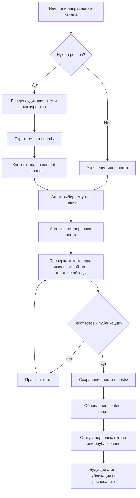

# Threads Text Writer

Проект для подготовки ежедневных постов в Threads.

Сейчас задача проекта простая: собирать идеи, превращать их в готовые тексты и вести контент-план. Автоматическая публикация будет добавлена отдельно, когда тексты и процесс будут понятны.

## Пайплайн

## Как работать

1. Открыть эту папку.
2. Рассказать агенту идею поста.
3. Агент оформляет идею в готовый текст.
4. Готовый пост сохраняется в `posts/`.
5. Контент-план обновляется в `content-plan.md`.

## Структура

- `AGENTS.md` — правила работы агента.
- `content-plan.md` — план публикаций.
- `posts/` — готовые и черновые посты.
- `research/` — ресерч, стратегия и выводы по каналу.
- `templates/post-template.md` — шаблон файла поста.

## Статусы постов

- `идея` — тема записана, текста ещё нет.
- `черновик` — есть первый вариант текста.
- `готово` — текст можно публиковать.
- `опубликовано` — пост уже вышел.
